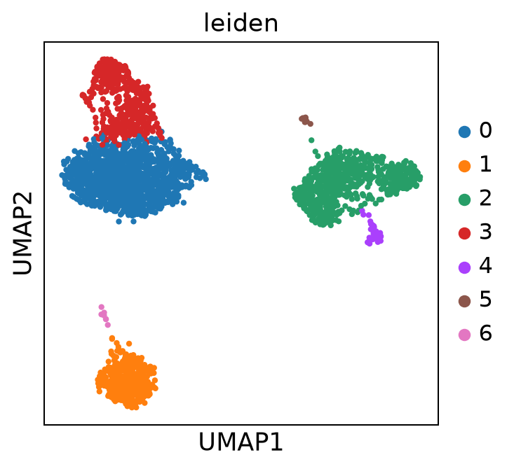
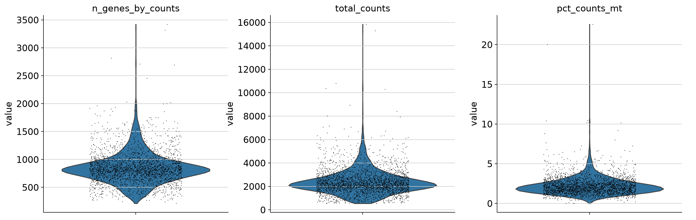
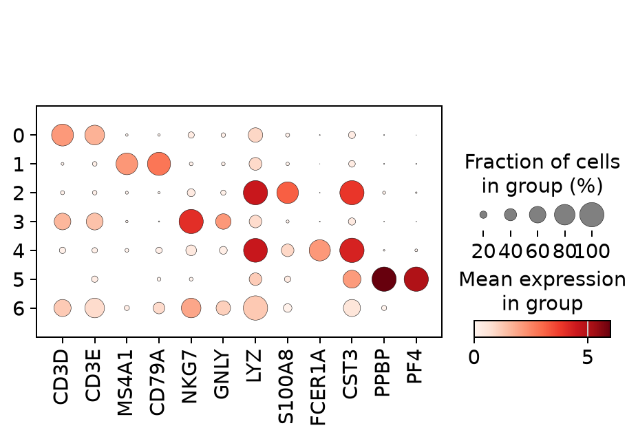

# Exploring immune cell populations with single-cell RNA-seq

This project uses **Scanpy** and a public PBMC 3k count dataset to work through the decisions involved in single-cell analysis: which cells pass quality control, how clusters form, and what marker genes tell us about them.

I started with blood immune cells to build a workflow I can later adapt to questions about the tumor microenvironment in glioblastoma. The results shown here are from PBMCs, not tumor samples.



## Analysis

The script loads the public PBMC 3k dataset, calculates mitochondrial and gene-count QC metrics, filters cells, normalizes and log-transforms counts, selects highly variable genes, and runs PCA, nearest-neighbor analysis, UMAP, and Leiden clustering. Wilcoxon marker rankings help identify which genes distinguish the resulting clusters.





The marker panel looks at familiar immune-cell signatures, including CD3D/CD3E for T cells, MS4A1/CD79A for B cells, and NKG7/GNLY for NK cells. I use these as clues rather than assigning definitive cell identities from a UMAP alone.

## Run the workflow

```bash
git clone https://github.com/palrabheru/single-cell-rnaseq-analysis.git
cd single-cell-rnaseq-analysis
python -m venv .venv
# Activate .venv for your operating system
python -m pip install -r requirements.txt
python -m src.analyze
```

For the QC unit tests:

```bash
python -m pytest -q
```

The dataset is downloaded through Scanpy when needed. Outputs go to `results/`, including figures, cluster and marker tables, and a processed AnnData file. The tracked [results folder](results/) includes selected plots and tables to browse without running the analysis.

## Notes on interpretation

QC cutoffs are starting points, not universal rules. The script filters below 200 detected genes and above 20% mitochondrial counts; those decisions should be revisited for each dataset. Cluster-associated genes are exploratory and need biological review. Doublets, donor effects, and batch structure are especially important before transferring the approach to patient tumors.

I'm interested in extending this work to [GSE131928](https://www.ncbi.nlm.nih.gov/geo/query/acc.cgi?acc=GSE131928), a glioblastoma single-cell study. Its processed TPM measurements would require different handling from the raw PBMC counts used here.

**References:** [Scanpy documentation](https://scanpy.readthedocs.io/) · [PBMC 3k dataset](https://scanpy.readthedocs.io/en/stable/generated/scanpy.datasets.pbmc3k.html) · **Author:** [Pal Rabheru](https://github.com/palrabheru)
